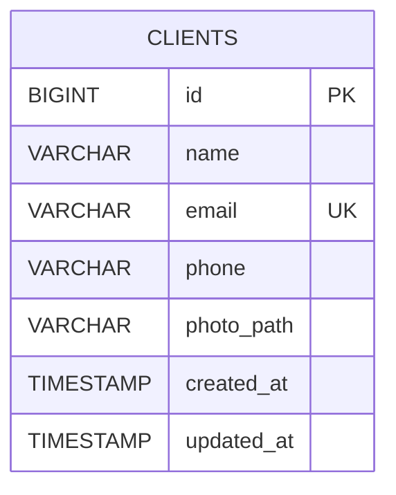

# Modelo Relacional — Cadastro de Clientes

## 1. Visão geral

O sistema de cadastro de clientes utiliza o PostgreSQL para persistir os dados dos clientes cadastrados.

O modelo relacional é composto pela tabela `clients`, responsável por armazenar os dados pessoais e o caminho da foto de cada cliente.

## 2. Estrutura da tabela `clients`

| Campo | Tipo de dado | Restrições | Descrição |
|---|---|---|---|
| `id` | BIGINT | Chave primária, incremento automático | Identificador único do cliente |
| `name` | VARCHAR(255) | NOT NULL | Nome do cliente |
| `email` | VARCHAR(255) | NOT NULL, UNIQUE | E-mail do cliente |
| `phone` | VARCHAR(30) | NOT NULL | Telefone do cliente |
| `photo_path` | VARCHAR(255) | NULL permitido | Caminho da foto armazenada no servidor |
| `created_at` | TIMESTAMP | NULL permitido | Data e hora de criação do registro |
| `updated_at` | TIMESTAMP | NULL permitido | Data e hora da última atualização |

## 3. Diagrama do modelo relacional

## 4. Chaves e restrições

- **Chave primária:** o campo `id` identifica exclusivamente cada registro.
- **Restrição de unicidade:** o campo `email` não permite valores duplicados.
- **Campos obrigatórios:** `name`, `email` e `phone` não aceitam valores nulos.
- **Campo opcional:** `photo_path` permite valores nulos, possibilitando cadastrar clientes sem foto.
- **Timestamps:** `created_at` e `updated_at` registram as datas de criação e atualização dos registros.

## 5. Relacionamentos

A tabela `clients` não possui relacionamentos com outras tabelas da aplicação. Cada registro representa um cliente independente.

## 6. Armazenamento das fotos

As imagens são enviadas pelo formulário e armazenadas no sistema de arquivos do servidor. O banco de dados armazena somente o caminho da imagem no campo `photo_path`, sem guardar o conteúdo binário da foto diretamente na tabela.

## 7. Persistência e operações

A aplicação utiliza o Laravel Eloquent ORM para criar, consultar, atualizar e excluir os registros de clientes.

A estrutura da tabela é definida por uma migration do Laravel, permitindo reproduzir a estrutura do banco de dados durante a instalação do projeto.